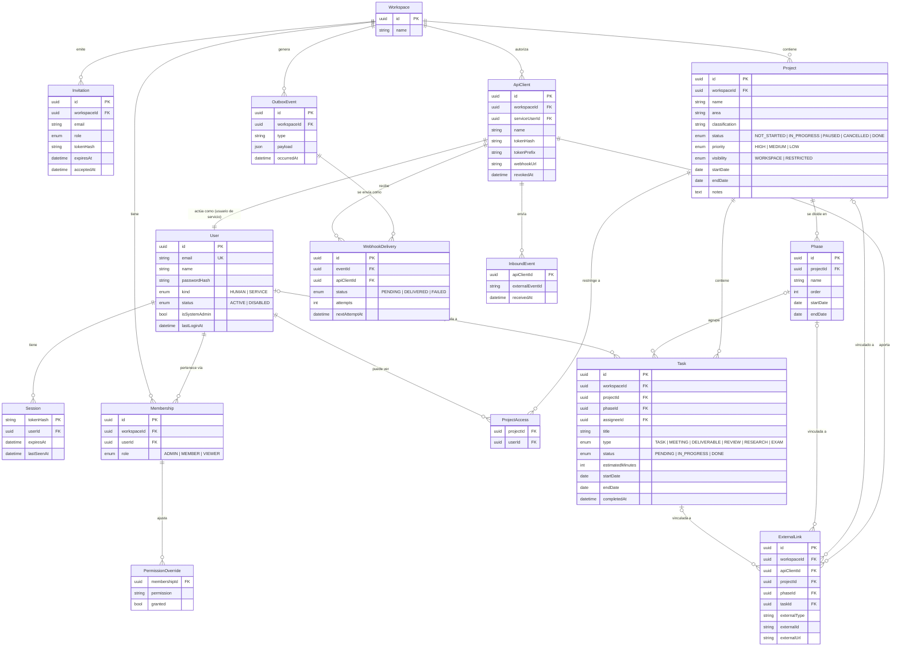

# ADR-0002: Modelo de datos, permisos y borrado

- **Estado:** Aceptado al fusionar su Pull Request (aprobación del Product Owner)
- **Fecha:** 2026-10-23
- **Relacionado con:** ADR-0001 (stack) · [backlog.md](../backlog.md) (decisiones del PO, RNF-01 a RNF-05) · TEC-01

> **Por qué este ADR:** cambiar la estructura de la base de datos cuando ya tiene información es caro y arriesgado. Por eso se diseña **todo el modelo del MVP** ahora, aunque en el Sprint 1 solo se implementen `User`, `Session`, `Workspace` y `Membership`.

## Contexto

Las decisiones del Product Owner del 2026-10-23 exigen:

1. Registro **solo por invitación**.
2. Roles **por workspace** (Admin, Miembro, Lector) + **ajustes de permisos por usuario**.
3. Proyectos **públicos o restringidos**.
4. **Borrado lógico** (papelera) y **físico solo desde la papelera**, solo Admin.
5. **Trazabilidad**: quién creó, modificó y borró cada registro.
6. **Integración con otros sistemas en ambas direcciones**, empezando por la futura app de estudio (cursos + Lexika). Ejemplo: el proyecto "Certificación Linux" de este gestor se vincula al curso "Certificación Linux" de la app de estudio; el avance del curso completa tareas aquí, y los cambios de fechas aquí avisan a la app de estudio.

## Decisión

### 1. Diagrama de entidades



> Para que el diagrama se lea mejor, se omiten los campos de trazabilidad (sección 3), que llevan todas las entidades de negocio.

**Qué se implementa y cuándo:**

| Entidad | Para qué | Sprint |
|---|---|---|
| `User` | Personas con cuenta | 1 |
| `Session` | Sesiones activas (login) | 1 |
| `Workspace` | Espacio de trabajo | 1 |
| `Membership` | Usuario + workspace + **rol** | 1 |
| `Invitation` | Invitaciones de un solo uso | 2 |
| `Project` | Proyectos | 2 |
| `Phase` | Fases o entregables | 3 |
| `Task` | Tareas | 2 |
| `ProjectAccess` | Quién ve un proyecto restringido | 3 |
| `PermissionOverride` | Ajustes de permisos por usuario | 4 |
| `ApiClient` | Credenciales de una app externa (con su usuario de servicio) | Integraciones (post-MVP) |
| `ExternalLink` | Vínculo entre un proyecto, fase o tarea y un recurso de otro sistema | Integraciones |
| `OutboxEvent` + `WebhookDelivery` | Avisos salientes (webhooks) sin perder ninguno | Integraciones |
| `InboundEvent` | Avisos entrantes ya procesados (evita procesarlos dos veces) | Integraciones |

Los campos de `Project`, `Phase` y `Task` salen del **prototipo** (sección 1.1) y de las decisiones del PO. Los de las entidades de integración son **orientativos**. Todos se pueden afinar en la planificación de su sprint, sin romper las reglas de este ADR.

### 1.1 Origen: el prototipo "Gestor de cursos"

El alcance del MVP (acta, sección 3) proviene de un prototipo de un solo archivo HTML para gestionar cursos. El Gestor de Proyectos es su **generalización**:

| Prototipo | Gestor de Proyectos | Cambios decididos por el PO (2026-10-23) |
|---|---|---|
| Curso | `Project` | "Plataforma" pasa a ser **`area`** (texto libre, por ejemplo Personal, Trabajo, Estudio o Cliente X). `classification` sigue siendo texto libre. En ambos, las opciones de los filtros salen de los valores existentes. |
| Unidad | `Phase` | Se agrega `order` para ordenarlas. |
| Actividad | `Task` | "Completada sí/no" pasa a ser **estados**: Pendiente, En curso, Hecha. Se agregan responsable (`assigneeId`) y `completedAt`. Los tipos de curso se reemplazan por una **lista genérica**: Tarea, Reunión, Entregable, Revisión, Investigación, Examen. |

**Valores que se conservan del prototipo** (con sus etiquetas en español en la interfaz):

| Campo | Valores |
|---|---|
| `Project.status` | No iniciado (`NOT_STARTED`), En curso (`IN_PROGRESS`), Pausado (`PAUSED`), Cancelado (`CANCELLED`), Terminado (`DONE`); cada uno con el color del prototipo |
| `Project.priority` | Alta (`HIGH`), Media (`MEDIUM`), Baja (`LOW`) |

**Reglas de cálculo** (HU-06), sin contar las tareas borradas:

- **% de avance** = tareas `DONE` ÷ total de tareas del proyecto (0 % si no tiene tareas).
- **Minutos pendientes** = suma de `estimatedMinutes` de las tareas que no están `DONE`.
- **Días restantes** respecto a `endDate`: "Faltan N día(s)", "Termina hoy", "Vencido hace N día(s)" o "Sin fecha".
- Al pasar una tarea a `DONE` se rellena `completedAt`; al salir de `DONE`, se vacía.
- _Nota (HU-24, 2026-10-25):_ por decisión del PO las tareas tienen además los estados **Pausada** (`PAUSED`, cuenta como pendiente) y **Cancelada** (`CANCELLED`, no cuenta en el % ni en los minutos). Ambos exigen un motivo (`statusReason`).

**Compatibilidad con los respaldos del prototipo** (HU-13 y HU-14): la exportación en **CSV con BOM UTF-8** (Excel lo abre directamente) y la importación aceptan el formato del prototipo (una fila por actividad, con sus 16 columnas) y lo convierten (curso → proyecto, unidad → fase, actividad → tarea, completada → `DONE`). Las fechas se normalizan a AAAA-MM-DD con las mismas reglas: las ambiguas se leen como día/mes/año, y se aceptan los números de serie de Excel. Así se pueden **migrar los datos existentes** del prototipo.

### 2. Convenciones generales

| Regla | Decisión | Por qué |
|---|---|---|
| Identificadores | **UUID v7** (`@default(uuid(7))`) | No se pueden adivinar (con `/projects/5` un atacante prueba `/projects/6`); facilitan importar y exportar; la v7 está ordenada por tiempo, lo que es eficiente para los índices. |
| Nombres en la BD | Tablas y columnas en `snake_case` y plural (`@@map`, `@map`); en TypeScript, `camelCase` | Convención estándar de PostgreSQL sin renunciar a la de TypeScript. |
| Fechas con hora | `timestamptz` (con zona horaria), guardadas en UTC | Evita errores al cambiar de horario o de país. |
| Fechas sin hora | `date` (inicio y fin de proyecto, vencimiento de tarea) | "Termina el 15 de noviembre" no tiene hora. |
| Correos | Se guardan en minúsculas y sin espacios; únicos | `Ana@x.com` y `ana@x.com` son la misma persona. |
| `workspaceId` en las tablas de negocio | **Siempre**, incluso en `Task` (aunque podría deducirse de `Project`) | Filtrar "solo lo de este workspace" es directo y difícil de olvidar: es la frontera de seguridad principal. |

### 3. Trazabilidad (RNF-01)

Todas las **entidades de negocio** (`Workspace`, `Membership`, `Invitation`, `Project`, `ProjectAccess`, `Phase`, `Task`, `PermissionOverride`, `ApiClient`, `ExternalLink`) llevan:

| Campo | Contenido |
|---|---|
| `createdAt`, `createdById` | Cuándo y quién lo creó |
| `updatedAt`, `updatedById` | Cuándo y quién lo modificó por última vez |
| `deletedAt`, `deletedById` | Cuándo y quién lo mandó a la papelera (`null` = no borrado) |

- `createdById` es **nulo** solo para lo que crea el sistema, como el primer Admin con `setup:admin`.
- Cuando el cambio lo hace una **app externa**, el campo apunta a su **usuario de servicio** (sección 8). Así la trazabilidad muestra, por ejemplo, "tarea completada por: App de estudio".
- Los campos los rellena la **capa de servicios** con el usuario de la sesión, mediante una función auxiliar común. Se descartó rellenarlos "por magia" con una extensión de Prisma: es más difícil de entender y de probar.
- **Alcance:** RNF-01 guarda el **último** cambio, no el historial completo. El historial (bitácora de auditoría) está en el backlog futuro del acta.

### 4. Borrado lógico y físico (RNF-05, HU-15)

```
   Registro activo ──(Admin: "Borrar")──► Papelera (deletedAt ≠ null)
                                              │
               ┌──────(Admin: "Restaurar")────┤
               ▼                              │
        Registro activo                       └──(Admin: "Borrar definitivamente"
                                                   + escribir el nombre)──► Eliminado de la BD
```

- **Lógico:** se rellena `deletedAt` + `deletedById`. Todas las consultas normales filtran `deletedAt: null`.
- **Cascada lógica:** si un proyecto va a la papelera, sus fases y tareas **desaparecen con él** sin marcarlas una por una (se ocultan porque su padre está borrado). Al restaurar el proyecto, vuelven.
- **Físico:** solo desde la papelera, solo Admin y con confirmación. Las claves foráneas usan `onDelete: Cascade` hacia los hijos (proyecto → fases → tareas → accesos).
- **Cómo se garantiza el filtro:** cada módulo tiene un **repositorio** (funciones de acceso a datos) que incluye `deletedAt: null` de forma explícita, y **pruebas** que verifican que lo borrado no aparece. Se descartó una extensión automática de Prisma porque no cubre todos los tipos de consulta y oculta la regla.
- **Unicidad con borrado lógico:** "un usuario solo puede ser miembro una vez de un workspace" debe aplicar solo a los registros **no borrados**. Se implementa con un **índice único parcial** (`WHERE deleted_at IS NULL`).
  - _Nota de implementación (TEC-01, 2026-10-23):_ Prisma 7.10 sí lo expresa en el esquema con la función en vista previa `partialIndexes` (`@@unique([...], where: { deletedAt: null })`). Se usa eso en lugar de SQL manual: así Prisma conoce el índice y no lo elimina en migraciones futuras.

**Excepciones (no tienen borrado lógico):**

| Entidad | Qué se hace | Por qué |
|---|---|---|
| `User` | **Nunca se borra físicamente**: se **desactiva** (`status = DISABLED`) y se cierran sus sesiones | Su ID aparece en `createdById`, `updatedById`... de toda la información. Borrarlo rompería la trazabilidad. Si un día se necesita borrarlo por privacidad, se **anonimizará** (otro ADR). |
| `Session` | Se elimina físicamente al cerrar sesión o al expirar | Es un dato técnico temporal, no información de negocio. |
| `Invitation` | Se marca como aceptada (`acceptedAt`) o revocada (`revokedAt`) | Su ciclo de vida ya es un historial. |
| `ApiClient` | Se **revoca** (`revokedAt`); su usuario de servicio se desactiva | Igual que `User`: sus cambios quedan en la trazabilidad. |
| `OutboxEvent`, `WebhookDelivery`, `InboundEvent` | Se depuran físicamente pasado un plazo (por ejemplo, 90 días) | Son registros técnicos de entrega, no información de negocio. |

### 5. Permisos (RNF-02, HU-04, HU-16, HU-17)

**Catálogo de permisos**, definido **en código** (`packages/shared`), no en la base de datos:

| Permiso | Admin | Miembro | Lector |
|---|---|---|---|
| `project.read` | ✅ | ✅ | ✅ |
| `project.create` | ✅ | ✅ | ❌ |
| `project.update` | ✅ | ✅ | ❌ |
| `project.delete` (a la papelera) | ✅ | ❌ | ❌ |
| `task.create` / `task.update` | ✅ | ✅ | ❌ |
| `task.delete` | ✅ | ✅ | ❌ |
| `data.export` | ✅ | ✅ | ❌ |
| `data.import` | ✅ | ❌ | ❌ |
| `member.manage` (invitar, cambiar rol, quitar) | ✅ | ❌ | ❌ |
| `workspace.update` (renombrar el espacio; HU-28) | ✅ | ❌ | ❌ |
| `trash.manage` (restaurar, borrar definitivamente) | ✅ | ❌ | ❌ |
| `integration.manage` (crear y revocar apps externas, vincular recursos) | ✅ | ❌ | ❌ |

> Esta tabla es la propuesta inicial; el PO puede ajustar los valores por defecto en cualquier momento, porque viven en un solo archivo.

**Permisos efectivos de un usuario en un workspace:**

```
permisos del rol (tabla anterior)
  + permisos concedidos en PermissionOverride (granted = true)
  − permisos retirados en PermissionOverride (granted = false)
```

- Un **Admin siempre tiene todos los permisos**; no se le aplican ajustes. Así nadie puede dejar un workspace sin administrador por error.
- _Decisión del PO (HU-28, 2026-10-25):_ el **Admin del sistema** (`isSystemAdmin`, el usuario creado con `setup:admin`) ve **todos** los espacios de trabajo y entra a cualquiera con rol **Admin**, aunque no sea miembro. Es la única excepción a "sin membresía → 404"; los espacios en la papelera tampoco los ve. Implementado en `modules/workspaces/access.ts` y `listWorkspacesForUser`, con pruebas.
- Debe existir **al menos un Admin** por workspace: no se puede degradar ni quitar al último.

**Visibilidad de proyectos (HU-16):**

| `visibility` | ¿Quién lo ve? |
|---|---|
| `WORKSPACE` (por defecto) | Todos los miembros del workspace |
| `RESTRICTED` | Solo los Admin + los usuarios listados en `ProjectAccess` |

Un usuario sin visibilidad sobre un proyecto **no lo ve en ningún lugar**: tablas, Kanban, búsquedas, exportaciones ni gráficas. Si intenta abrirlo por URL, recibe `404` (no `403`), para no revelar que existe.

**Cómo se verifica en cada petición:**

```
Petición ─► ¿Sesión válida? ─► ¿Usuario activo? ─► ¿Es miembro del workspace?
         ─► ¿Tiene el permiso de la acción? ─► ¿Puede ver ese proyecto? ─► Ejecutar
            (cualquier "no" corta la petición: 401, 403 o 404)
```

Se implementa con funciones reutilizables de Fastify (`preHandler`), como `requirePermission('project.create')`, para que ningún endpoint lo olvide.

### 6. Sesiones e invitaciones: guardar el hash, no el token

El navegador recibe un **token aleatorio** (256 bits); la base de datos guarda solo su **hash SHA-256**. Lo mismo para las invitaciones y los tokens de API de las apps externas.

**Por qué:** si alguien robara una copia de la base de datos, no podría usar esos hashes para hacerse pasar por nadie, porque necesitaría el token original, que solo tiene el navegador o el correo de la invitación.

### 7. Integración con otros sistemas (diseño; se implementa después del MVP)

**Principio: cada sistema es dueño de sus datos.** El gestor es dueño de proyectos, fases, tareas y fechas; la app de estudio, de cursos, lecciones, avance y Lexika. **No se comparte la base de datos**: si un sistema cambiara una tabla, rompería al otro. Se comparten **vínculos** y se comunican por **API** (consultar u ordenar) y **webhooks** (avisar de que algo pasó).

La futura **app de estudio** reunirá dos prototipos existentes: el **gestor de cursos** (curso → unidades → actividades) y **Lexika** (vocabulario con repetición espaciada y lectura).

```
┌──────────────────────────────┐            ┌──────────────────────────────┐
│     GESTOR DE PROYECTOS      │            │       APP DE ESTUDIO         │
│  Proyecto: "Certificación    │  API +     │  Curso: "Certificación       │
│   Linux LPIC-1"              │◄──────────►│   Linux LPIC-1"              │
│   ├ Fase: Módulo 101 ────────┼─ vínculo ──┼──► Unidad: Módulo 101        │
│   │  └ Tarea: Examen 101 ────┼─ vínculo ──┼──►  └ Actividad: Examen 101  │
│   └ Fase: Módulo 102         │  webhooks  │   └ Unidad: Módulo 102       │
└──────────────────────────────┘            └──────────────────────────────┘
       Base de datos propia                        Base de datos propia
```

**Piezas:**

| Pieza | Cómo funciona |
|---|---|
| **`ApiClient` + usuario de servicio** | El Admin registra una app externa en su workspace. Se crea un `User` con `kind = SERVICE` (no puede iniciar sesión con contraseña) y una `Membership` con rol `MEMBER`, cuyos permisos se ajustan con `PermissionOverride`. **La app externa usa el mismo sistema de permisos, visibilidad y trazabilidad que una persona.** |
| **Token de API** | La app se autentica con `Authorization: Bearer <token>`. Se guarda solo el hash (sección 6) y un prefijo visible (`gp_live_ab12…`) para identificarlo. Se muestra **una sola vez** al crearlo y se puede revocar. |
| **`ExternalLink`** | Vincula **exactamente uno** de proyecto, fase o tarea (restricción `CHECK` en SQL) con un recurso externo: `externalType` (en la app de estudio: `course`, `unit`, `activity`), `externalId` (el ID en el otro sistema, como texto, porque su formato no lo controlamos) y `externalUrl` (para abrirlo con un clic). |
| **Avisos salientes (Outbox)** | Cuando pasa algo relevante (`task.completed`, `project.dates_changed`…), el evento se guarda en `OutboxEvent` **en la misma transacción** que el cambio. Un proceso aparte lo envía a cada app suscrita (`WebhookDelivery`) y reintenta con espera creciente si la otra app está caída. **No se pierde ningún aviso.** |
| **Firma de webhooks** | Cada aviso va firmado (HMAC-SHA256 con un secreto por app y una marca de tiempo), para que el receptor compruebe que es auténtico y no repetido. El secreto se guarda **cifrado** con una clave del servidor (variable de entorno), porque hay que poder usarlo para firmar. |
| **Avisos entrantes** | La app de estudio avisa en `POST /api/v1/integrations/webhooks`. Se verifica la firma, y su ID de evento se guarda en `InboundEvent` (clave única): si llega dos veces, **no se procesa dos veces** (idempotencia). |
| **Contratos** | Los esquemas de los eventos y de la API se definen con Zod en `packages/shared` y se publican como OpenAPI (TEC-05). La app de estudio, cuando se construya, los usará para hablar el mismo idioma. |

**El ejemplo, de punta a punta:**

1. En el gestor creas el proyecto **"Certificación Linux"** con las fases "Módulo 101" y "Módulo 102".
2. El Admin registra la **app de estudio** como `ApiClient` y vincula cada fase con su unidad del curso (`ExternalLink`).
3. Completas la actividad "Examen 101" en la app de estudio → la app envía `activity.completed` → el gestor pasa la tarea vinculada a `DONE` (con `updatedBy` = "App de estudio") y **sube el % de avance** del proyecto.
4. Mueves la fecha límite del proyecto en el gestor → `OutboxEvent` `project.dates_changed` → la app de estudio recibe el aviso y **reajusta tu plan de estudio**.

**Nota para la app de estudio:** el prototipo de Lexika guarda la clave de la API de IA en el navegador y llama a la IA directamente desde ahí, algo aceptable solo para uso personal. En la versión integrada, esas llamadas deberán pasar por su servidor, y la clave nunca debe llegar al navegador.

### 8. Stack de acceso a datos

| Pieza | Versión / detalle |
|---|---|
| Prisma | **7.10.1** (última estable; la 8 aún es versión candidata) |
| Conexión | Adaptador `@prisma/adapter-pg` + driver `pg` (JavaScript puro, sin motor nativo para consultas) |
| Configuración | `prisma.config.ts` + `DATABASE_URL` validada con Zod en `config/env.ts` |
| Migraciones | `prisma migrate dev` (desarrollo) y `prisma migrate deploy` (CI y producción), versionadas en Git |
| Prueba en Windows | ✅ El motor de migraciones y el cliente funcionan con Smart App Control activo (prueba del 2026-10-23) |
| Hash de contraseñas | Argon2id con `argon2` 0.45 (✅ probado en Windows). Alternativa probada: `@node-rs/argon2` |

## Alternativas consideradas

| Alternativa | Por qué se descartó |
|---|---|
| IDs numéricos autoincrementales | Se pueden adivinar y enumerar; complican la importación entre instalaciones. |
| Tablas de archivo para lo borrado (mover registros a `projects_archive`) | Duplica el esquema y complica restaurar. |
| Filtro automático de borrados con una extensión de Prisma | No cubre todas las consultas y oculta una regla de seguridad. |
| Permisos y roles guardados en tablas (roles personalizados) | El PO eligió roles fijos + ajustes; un catálogo en código es más simple y se prueba mejor. |
| Row Level Security de PostgreSQL | Muy robusto, pero añade complejidad que no se justifica para un equipo pequeño. Se puede adoptar después sin cambiar el modelo. |
| Guardar los tokens de sesión en claro | Una copia robada de la BD permitiría suplantar usuarios. |
| JWT en lugar de sesiones | Ya decidido en ADR-0001: las sesiones en BD se pueden revocar al instante. |
| Base de datos compartida entre el gestor y la app de estudio | Acopla los dos sistemas: un cambio en una tabla rompe al otro, y ninguno puede evolucionar ni desplegarse por separado. |
| Que la app de estudio consulte cada cierto tiempo si hubo cambios (_polling_) | Avisos tardíos y peticiones inútiles; los webhooks avisan al momento. Se mantiene como respaldo para resincronizar. |
| Enviar el webhook directamente al guardar, sin Outbox | Si la otra app está caída o el servidor se reinicia, el aviso se pierde. |
| Permisos separados para apps externas (_scopes_ propios) | Duplicaría el sistema de permisos; el usuario de servicio reutiliza roles, ajustes, visibilidad y trazabilidad. |

## Consecuencias

- (+) Un modelo único para todo el MVP: los sprints 2–4 agregan tablas sin rehacer las existentes.
- (+) La seguridad (workspace, permisos, visibilidad, borrado) se aplica en un solo lugar y se prueba.
- (+) La trazabilidad y la papelera protegen contra errores humanos.
- (+) Preparado para integrarse con la app de estudio y otras apps sin rehacer tablas, con las mismas reglas de seguridad para personas y apps.
- (−) Cada consulta debe respetar `deletedAt` y `workspaceId`: exige disciplina y pruebas en cada historia.
- (−) Las integraciones requieren un proceso en segundo plano (envío de webhooks), que el hosting gratuito debe soportar; se verificará al elegir el hosting (Sprint 3).
- (−) Los usuarios no se borran físicamente; el derecho al olvido requerirá anonimización (pendiente).
- (+) Compatible con los respaldos del prototipo: los datos existentes se pueden migrar.
- (+) La exportación "Excel" en CSV no requiere dependencias nuevas.
- Dependencias que se instalarán en TEC-01 y HU-02 (pendientes de aprobación en su PR): `prisma`, `@prisma/client`, `@prisma/adapter-pg`, `pg`, `argon2`.
