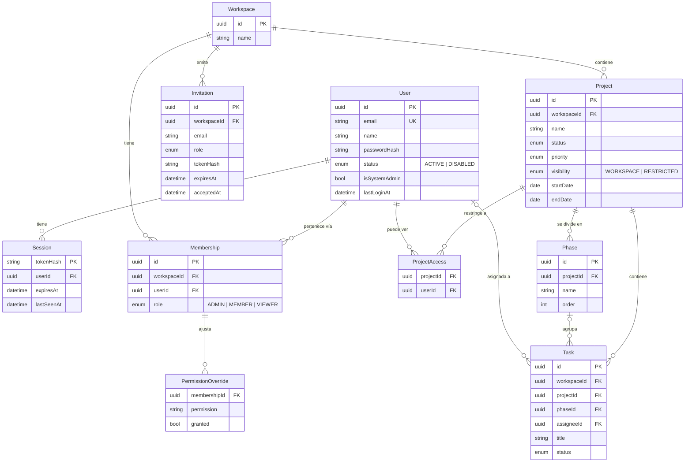

# ADR-0002: Modelo de datos, permisos y borrado

- **Estado:** Aceptado al fusionar su Pull Request (aprobación del Product Owner)
- **Fecha:** 2026-10-23
- **Relacionado con:** ADR-0001 (stack) · [backlog.md](../backlog.md) (decisiones del PO, RNF-01 a RNF-05) · TEC-01

> **Por qué este ADR:** cambiar la estructura de la base de datos cuando ya tiene información es caro y arriesgado. Por eso se diseña **todo el modelo del MVP** ahora, aunque en el Sprint 1 solo se implementen `User`, `Session`, `Workspace` y `Membership`.

## Contexto

Las decisiones del Product Owner del 2026-10-23 exigen:

1. Registro **solo por invitación**.
2. Roles **por workspace** (Admin, Miembro, Lector) + **ajustes de permisos por usuario**.
3. Proyectos **públicos o restringidos**.
4. **Borrado lógico** (papelera) y **físico solo desde la papelera**, solo Admin.
5. **Trazabilidad**: quién creó, modificó y borró cada registro.

## Decisión

### 1. Diagrama de entidades



> Para que el diagrama se lea mejor, se omiten los campos de trazabilidad (sección 3), que llevan todas las entidades de negocio.

**Qué se implementa y cuándo:**

| Entidad | Para qué | Sprint |
|---|---|---|
| `User` | Personas con cuenta | 1 |
| `Session` | Sesiones activas (login) | 1 |
| `Workspace` | Espacio de trabajo | 1 |
| `Membership` | Usuario + workspace + **rol** | 1 |
| `Invitation` | Invitaciones de un solo uso | 2 |
| `Project` | Proyectos | 2 |
| `Phase` | Fases o entregables | 3 |
| `Task` | Tareas | 2 |
| `ProjectAccess` | Quién ve un proyecto restringido | 3 |
| `PermissionOverride` | Ajustes de permisos por usuario | 4 |

Los campos de `Project`, `Phase` y `Task` son **orientativos**: se afinan en la planificación de su sprint, sin romper las reglas de este ADR.

### 2. Convenciones generales

| Regla | Decisión | Por qué |
|---|---|---|
| Identificadores | **UUID v7** (`@default(uuid(7))`) | No se pueden adivinar (con `/projects/5` un atacante prueba `/projects/6`); facilitan importar y exportar; la v7 está ordenada por tiempo, lo que es eficiente para los índices. |
| Nombres en la BD | Tablas y columnas en `snake_case` y plural (`@@map`, `@map`); en TypeScript, `camelCase` | Convención estándar de PostgreSQL sin renunciar a la de TypeScript. |
| Fechas con hora | `timestamptz` (con zona horaria), guardadas en UTC | Evita errores al cambiar de horario o de país. |
| Fechas sin hora | `date` (inicio y fin de proyecto, vencimiento de tarea) | "Termina el 15 de noviembre" no tiene hora. |
| Correos | Se guardan en minúsculas y sin espacios; únicos | `Ana@x.com` y `ana@x.com` son la misma persona. |
| `workspaceId` en las tablas de negocio | **Siempre**, incluso en `Task` (aunque podría deducirse de `Project`) | Filtrar "solo lo de este workspace" es directo y difícil de olvidar: es la frontera de seguridad principal. |

### 3. Trazabilidad (RNF-01)

Todas las **entidades de negocio** (`Workspace`, `Membership`, `Invitation`, `Project`, `ProjectAccess`, `Phase`, `Task`, `PermissionOverride`) llevan:

| Campo | Contenido |
|---|---|
| `createdAt`, `createdById` | Cuándo y quién lo creó |
| `updatedAt`, `updatedById` | Cuándo y quién lo modificó por última vez |
| `deletedAt`, `deletedById` | Cuándo y quién lo mandó a la papelera (`null` = no borrado) |

- `createdById` es **nulo** solo para lo que crea el sistema, como el primer Admin con `setup:admin`.
- Los campos los rellena la **capa de servicios** con el usuario de la sesión, mediante una función auxiliar común. Se descartó rellenarlos "por magia" con una extensión de Prisma: es más difícil de entender y de probar.
- **Alcance:** RNF-01 guarda el **último** cambio, no el historial completo. El historial (bitácora de auditoría) está en el backlog futuro del acta.

### 4. Borrado lógico y físico (RNF-05, HU-15)

```
   Registro activo ──(Admin: "Borrar")──► Papelera (deletedAt ≠ null)
                                              │
               ┌──────(Admin: "Restaurar")────┤
               ▼                              │
        Registro activo                       └──(Admin: "Borrar definitivamente"
                                                   + escribir el nombre)──► Eliminado de la BD
```

- **Lógico:** se rellena `deletedAt` + `deletedById`. Todas las consultas normales filtran `deletedAt: null`.
- **Cascada lógica:** si un proyecto va a la papelera, sus fases y tareas **desaparecen con él** sin marcarlas una por una (se ocultan porque su padre está borrado). Al restaurar el proyecto, vuelven.
- **Físico:** solo desde la papelera, solo Admin y con confirmación. Las claves foráneas usan `onDelete: Cascade` hacia los hijos (proyecto → fases → tareas → accesos).
- **Cómo se garantiza el filtro:** cada módulo tiene un **repositorio** (funciones de acceso a datos) que incluye `deletedAt: null` de forma explícita, y **pruebas** que verifican que lo borrado no aparece. Se descartó una extensión automática de Prisma porque no cubre todos los tipos de consulta y oculta la regla.
- **Unicidad con borrado lógico:** "un usuario solo puede ser miembro una vez de un workspace" debe aplicar solo a los registros **no borrados**. Se implementa con un **índice único parcial** (`WHERE deleted_at IS NULL`) escrito en SQL dentro de la migración, porque Prisma no lo expresa directamente.

**Excepciones (no tienen borrado lógico):**

| Entidad | Qué se hace | Por qué |
|---|---|---|
| `User` | **Nunca se borra físicamente**: se **desactiva** (`status = DISABLED`) y se cierran sus sesiones | Su ID aparece en `createdById`, `updatedById`... de toda la información. Borrarlo rompería la trazabilidad. Si un día se necesita borrarlo por privacidad, se **anonimizará** (otro ADR). |
| `Session` | Se elimina físicamente al cerrar sesión o al expirar | Es un dato técnico temporal, no información de negocio. |
| `Invitation` | Se marca como aceptada (`acceptedAt`) o revocada (`revokedAt`) | Su ciclo de vida ya es un historial. |

### 5. Permisos (RNF-02, HU-04, HU-16, HU-17)

**Catálogo de permisos**, definido **en código** (`packages/shared`), no en la base de datos:

| Permiso | Admin | Miembro | Lector |
|---|---|---|---|
| `project.read` | ✅ | ✅ | ✅ |
| `project.create` | ✅ | ✅ | ❌ |
| `project.update` | ✅ | ✅ | ❌ |
| `project.delete` (a la papelera) | ✅ | ❌ | ❌ |
| `task.create` / `task.update` | ✅ | ✅ | ❌ |
| `task.delete` | ✅ | ✅ | ❌ |
| `data.export` | ✅ | ✅ | ❌ |
| `data.import` | ✅ | ❌ | ❌ |
| `member.manage` (invitar, cambiar rol, quitar) | ✅ | ❌ | ❌ |
| `trash.manage` (restaurar, borrar definitivamente) | ✅ | ❌ | ❌ |

> Esta tabla es la propuesta inicial; el PO puede ajustar los valores por defecto en cualquier momento, porque viven en un solo archivo.

**Permisos efectivos de un usuario en un workspace:**

```
permisos del rol (tabla anterior)
  + permisos concedidos en PermissionOverride (granted = true)
  − permisos retirados en PermissionOverride (granted = false)
```

- Un **Admin siempre tiene todos los permisos**; no se le aplican ajustes. Así nadie puede dejar un workspace sin administrador por error.
- Debe existir **al menos un Admin** por workspace: no se puede degradar ni quitar al último.

**Visibilidad de proyectos (HU-16):**

| `visibility` | ¿Quién lo ve? |
|---|---|
| `WORKSPACE` (por defecto) | Todos los miembros del workspace |
| `RESTRICTED` | Solo los Admin + los usuarios listados en `ProjectAccess` |

Un usuario sin visibilidad sobre un proyecto **no lo ve en ningún lugar**: tablas, Kanban, búsquedas, exportaciones ni gráficas. Si intenta abrirlo por URL, recibe `404` (no `403`), para no revelar que existe.

**Cómo se verifica en cada petición:**

```
Petición ─► ¿Sesión válida? ─► ¿Usuario activo? ─► ¿Es miembro del workspace?
         ─► ¿Tiene el permiso de la acción? ─► ¿Puede ver ese proyecto? ─► Ejecutar
            (cualquier "no" corta la petición: 401, 403 o 404)
```

Se implementa con funciones reutilizables de Fastify (`preHandler`), como `requirePermission('project.create')`, para que ningún endpoint lo olvide.

### 6. Sesiones e invitaciones: guardar el hash, no el token

El navegador recibe un **token aleatorio** (256 bits); la base de datos guarda solo su **hash SHA-256**. Lo mismo para las invitaciones.

**Por qué:** si alguien robara una copia de la base de datos, no podría usar esos hashes para hacerse pasar por nadie, porque necesitaría el token original, que solo tiene el navegador o el correo de la invitación.

### 7. Stack de acceso a datos

| Pieza | Versión / detalle |
|---|---|
| Prisma | **7.10.1** (última estable; la 8 aún es versión candidata) |
| Conexión | Adaptador `@prisma/adapter-pg` + driver `pg` (JavaScript puro, sin motor nativo para consultas) |
| Configuración | `prisma.config.ts` + `DATABASE_URL` validada con Zod en `config/env.ts` |
| Migraciones | `prisma migrate dev` (desarrollo) y `prisma migrate deploy` (CI y producción), versionadas en Git |
| Prueba en Windows | ✅ El motor de migraciones y el cliente funcionan con Smart App Control activo (prueba del 2026-10-23) |
| Hash de contraseñas | Argon2id con `argon2` 0.45 (✅ probado en Windows). Alternativa probada: `@node-rs/argon2` |

## Alternativas consideradas

| Alternativa | Por qué se descartó |
|---|---|
| IDs numéricos autoincrementales | Se pueden adivinar y enumerar; complican la importación entre instalaciones. |
| Tablas de archivo para lo borrado (mover registros a `projects_archive`) | Duplica el esquema y complica restaurar. |
| Filtro automático de borrados con una extensión de Prisma | No cubre todas las consultas y oculta una regla de seguridad. |
| Permisos y roles guardados en tablas (roles personalizados) | El PO eligió roles fijos + ajustes; un catálogo en código es más simple y se prueba mejor. |
| Row Level Security de PostgreSQL | Muy robusto, pero añade complejidad que no se justifica para un equipo pequeño. Se puede adoptar después sin cambiar el modelo. |
| Guardar los tokens de sesión en claro | Una copia robada de la BD permitiría suplantar usuarios. |
| JWT en lugar de sesiones | Ya decidido en ADR-0001: las sesiones en BD se pueden revocar al instante. |

## Consecuencias

- (+) Un modelo único para todo el MVP: los sprints 2–4 agregan tablas sin rehacer las existentes.
- (+) La seguridad (workspace, permisos, visibilidad, borrado) se aplica en un solo lugar y se prueba.
- (+) La trazabilidad y la papelera protegen contra errores humanos.
- (−) Cada consulta debe respetar `deletedAt` y `workspaceId`: exige disciplina y pruebas en cada historia.
- (−) Los usuarios no se borran físicamente; el derecho al olvido requerirá anonimización (pendiente).
- Dependencias que se instalarán en TEC-01 y HU-02 (pendientes de aprobación en su PR): `prisma`, `@prisma/client`, `@prisma/adapter-pg`, `pg`, `argon2`.
