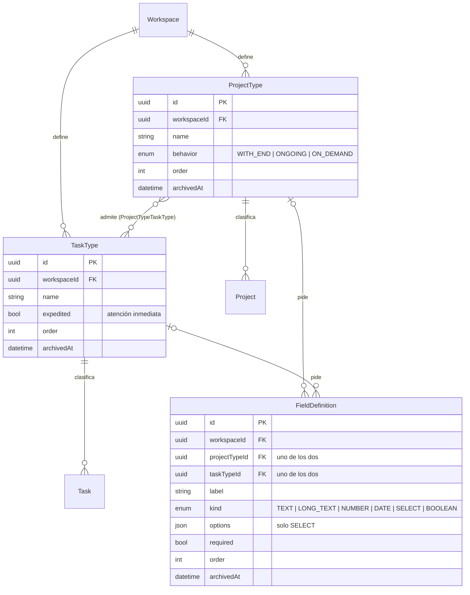

# ADR-0004: Tipos de trabajo configurables

- **Estado:** Aceptado (2026-10-25)
- **Fecha:** 2026-10-24
- **Decide:** Product Owner, a propuesta del equipo técnico
- **Contexto:** Además de proyectos, el PO necesita gestionar **mantenimientos** (correctivos, evolutivos…) y **actividades que no pertenecen a ningún proyecto**. Las tareas también necesitan más clasificaciones (incidencia, fast track…), y cada tipo debe llevar **su propio detalle**. Hoy el modelo (ADR-0002) tiene un solo tipo de contenedor (`Project`) y una lista fija de tipos de tarea (`TaskType`: Tarea, Reunión, Entregable, Revisión, Investigación, Examen). Los prototipos de `docs/FueraDelProyecto` no cubren este caso: es alcance nuevo.

## Decisiones del PO (2026-10-24)

| Tema | Decisión |
|---|---|
| Tipos | **Configurables:** cada espacio de trabajo tiene catálogos que se pueden ampliar (no listas fijas en el código). |
| Quién los configura | El **Admin del espacio** (permiso nuevo `catalog.manage`). |
| Restricción | Cada tipo de contenedor puede **limitar qué tipos de tarea admite** (sin elegir ninguno = todos). |
| Detalle | **Campos de detalle por tipo**, en el Sprint 3, junto con los tipos. |

## Decisión

### 1. Tres catálogos por espacio de trabajo

```
Espacio de trabajo
 ├── Tipos de contenedor   Proyecto, Mtto correctivo, Mtto evolutivo, Actividades… (+ los que agregue el Admin)
 │     └── comportamiento: Con fin | Continuo | Por demanda  (lista fija: el sistema sabe medirlos)
 │     └── tipos de tarea permitidos (opcional)
 ├── Tipos de tarea        Tarea, Incidencia, Fast track, Reunión… (+ los que agregue el Admin)
 └── Campos de detalle     por tipo de contenedor o por tipo de tarea
```

En el código el contenedor sigue llamándose `Project` (no se renombra nada de lo ya hecho); en la interfaz se muestra el nombre de su tipo ("Mtto correctivo", "Actividades"…).

### 2. Comportamientos: el nombre es libre, la forma de medir no

El Admin inventa los tipos que quiera, pero cada uno elige **uno de tres comportamientos**. El comportamiento decide **qué se mide** (HU-06); las fechas planeadas son opcionales en los tres y las reales se registran siempre (sección 2.1):

| Comportamiento | Para qué | Uso de las fechas planeadas | Qué se mide |
|---|---|---|---|
| **Con fin** (`WITH_END`) | Proyectos | El fin planeado da los días restantes y el "vencido" | % de avance, minutos pendientes, días restantes (como hoy) |
| **Continuo** (`ONGOING`) | Mantenimientos, soporte | Periodo de referencia (p. ej. el del contrato); nunca se marca vencido | Tareas abiertas, **vencidas** y **hechas este mes**; sin % ni "vencido" del contenedor |
| **Por demanda** (`ON_DEMAND`) | Actividades que no son de un proyecto ni de un mantenimiento: trabajo que llega cuando se necesita | Opcionales, solo informativas | Tareas pendientes y vencidas |

Así, "Mtto preventivo" o "Auditoría" se agregan sin programar nada: basta elegir su comportamiento.

### 2.1 Fechas planeadas y fechas reales (decisión del PO, 2026-10-25)

Para poder hacer estadística, todo contenedor y toda tarea, **sea del tipo que sea**, guarda dos clases de fechas:

| | **Planeadas** (lo que se espera) | **Reales** (lo que pasó) |
|---|---|---|
| Campos | startDate, endDate | startedAt, finishedAt (en tareas, completedAt, que ya existe) |
| Quién las pone | La persona, en el formulario | **El sistema, automáticamente** |
| ¿Se pueden cambiar? | Sí, al replanear | No: son el registro histórico |
| ¿Obligatorias? | No, en ningún comportamiento | Se llenan solas al ocurrir el evento |

**Cuándo se registran las reales:**

| Entidad | Inicio real | Fin real |
|---|---|---|
| Tarea | La **primera vez** que pasa a En curso (o a Hecha, si se salta En curso) | Al pasar a Hecha |
| Contenedor | La **primera vez** que pasa a En curso (o a Terminado, si se salta En curso; igual que las tareas) | Al pasar a Terminado o Cancelado |

- Si una tarea sale de Hecha, su fin real se vacía (regla de HU-08), pero **su inicio real se conserva**: ya había empezado. Lo mismo con un contenedor que se reabre.
- La fecha de creación (createdAt, RNF-01) completa la información.

**Indicadores que habilita** (las gráficas llegan con HU-12, pero los datos se guardan desde HU-21 y HU-22, para no perder historia):

| Indicador | Cálculo | Útil para |
|---|---|---|
| Tiempo de atención | creación → fin real | Incidencias y Fast track: cuánto se tarda en resolver |
| Tiempo de espera | creación → inicio real | Cuánto tarda en empezar a atenderse una solicitud |
| Tiempo de trabajo | inicio real → fin real | Cuánto dura realmente cada tipo de tarea |
| Cumplimiento de plazo | fin real ≤ fin planeado | Qué % termina a tiempo |
| Desviación | fin real − fin planeado | Dónde se planea mal |

### 3. Campos de detalle ("el detalle que debe llevar cada uno")

Cada tipo de contenedor y cada tipo de tarea puede definir campos extra:

| Clase de campo | Ejemplo |
|---|---|
| Texto corto | Sistema afectado |
| Texto largo | Causa raíz |
| Número | Horas facturables |
| Fecha | Fecha de reporte |
| Lista de opciones | Severidad: Crítica, Alta, Media, Baja |
| Sí / No | ¿Requiere ventana de mantenimiento? |

Cada campo puede ser **obligatorio u opcional** y tiene un orden. En los formularios aparecen solos según el tipo elegido.

- **Dónde se guardan los valores:** una columna `details` (JSONB) en `projects` y en `tasks`, con los valores indexados por el ID del campo. Se descartó una tabla "campo-valor" (EAV): exige muchas uniones para leer una tarea y complica la exportación.
- **Validación:** la API arma el esquema Zod **a partir de la definición de los campos** en cada petición (RNF-03 sigue cumpliéndose: nada entra sin validar). Un valor que no es del tipo esperado, una opción que no existe o un obligatorio vacío → `400`.
- **Cambios en las definiciones:**
  - Renombrar un campo o agregar opciones a una lista: permitido.
  - **No se cambia la clase** de un campo con datos (de texto a número, por ejemplo): se crea otro campo. Así ningún valor guardado queda inválido.
  - Quitar un campo lo **archiva**: deja de mostrarse y de pedirse, pero sus valores se conservan (se pueden exportar).

### 4. Reglas de integridad

- Un tipo **en uso no se borra**: se **archiva** (deja de ofrecerse para lo nuevo; lo existente lo conserva).
- Cambiar el tipo de un contenedor solo se permite si **todas sus tareas** tienen un tipo permitido en el tipo nuevo (si no, `409` con la lista de tipos a corregir).
- Los nombres de tipos son únicos dentro del espacio (sin contar los archivados).
- Toda tabla nueva sigue el ADR-0002: UUID v7, trazabilidad (RNF-01) y `workspaceId`.

### 5. Valores iniciales (los ajusta el PO)

Al crear un espacio de trabajo (y, por migración, en los que ya existen) se cargan estos valores; después el Admin los modifica.

**Tipos de contenedor**

| Tipo | Comportamiento | Tipos de tarea permitidos | Campos de detalle propuestos |
|---|---|---|---|
| Proyecto | Con fin | Todos | Patrocinador (texto), Objetivo (texto largo) |
| Mtto correctivo | Continuo | Incidencia, Fast track, Tarea | Sistema o aplicación (texto, **obligatorio**) |
| Mtto evolutivo | Continuo | Tarea, Fast track, Entregable, Revisión | Solicitante (texto), Versión objetivo (texto) |
| Actividades | Por demanda | Todos | — |

**Tipos de tarea**

| Tipo | Campos de detalle propuestos |
|---|---|
| Tarea | — |
| Incidencia | Severidad (lista: Crítica, Alta, Media, Baja; **obligatorio**), Sistema afectado (texto), Fecha de reporte (fecha), Reportado por (texto), Causa raíz (texto largo) |
| Fast track | Se atiende **de inmediato, sin pasar por el proceso normal**. Justificación (texto largo, **obligatorio**), Autorizado por (texto, **obligatorio**), Impacto si no se atiende (texto largo) |
| Reunión, Entregable, Revisión, Investigación, Examen | — (son los tipos actuales; se conservan) |

**Atención inmediata (vía rápida):** cada tipo de tarea tiene una casilla **"Atención inmediata"**. Las tareas de esos tipos (como Fast track) se **resaltan** con una etiqueta y aparecen **primero** en su columna del tablero. Es una propiedad del tipo y no un nombre fijo: si mañana se crea "Urgencia de seguridad", también puede marcarse así.

**Migración de lo existente:** los proyectos actuales pasan al tipo "Proyecto"; las tareas conservan su tipo actual, que deja de ser un `enum` y pasa a apuntar al catálogo.

> **Nota de implementación (HU-21, 2026-10-26):** la migración `project_types` carga los tipos con SQL escrito a mano. PostgreSQL 17 no trae `uuidv7()`, así que arma un UUID v7 a partir de `gen_random_uuid()` y la marca de tiempo. Las fechas reales de lo que ya existía quedan vacías: no se sabe cuándo empezó de verdad. La restricción de tipos de tarea por tipo de contenedor se implementa en HU-22, junto con su catálogo.
>
> **Nota de implementación (HU-22, 2026-10-26):** la migración `task_types` pasa cada valor del antiguo enum al tipo del catálogo con el mismo sentido (TASK → Tarea, MEETING → Reunión…) y elimina el enum. Los tipos permitidos viven en la tabla `project_type_task_types` (sin filas = todos). Sin tipo pedido, una tarea recibe el primer tipo activo que admite su contenedor.

### 6. Modelo de datos (cambios sobre el ADR-0002)



- `Project` gana `typeId` (obligatorio), `details` (JSONB) y las fechas reales `startedAt` y `finishedAt` (sección 2.1).
- `Task.type` (enum) se reemplaza por `typeId` (catálogo) y gana `details` (JSONB) y la fecha real `startedAt` (el fin real ya es `completedAt`).
- Permiso nuevo `catalog.manage` (solo Admin) en el catálogo de permisos (ADR-0002 §5).

### 7. Impacto en otras historias

| Historia | Cambio |
|---|---|
| HU-06 Avance | Lo que se mide depende del comportamiento (sección 2) |
| HU-09 Tabla con filtros | Filtro por tipo; las columnas de fechas y % se adaptan al comportamiento |
| HU-10 Kanban | Filtro por tipo |
| HU-13 / HU-14 Exportar e importar | Columnas de tipo y de campos de detalle; el respaldo del prototipo se importa como tipo "Proyecto" |
| HU-12 Gráficas | Se pueden separar por tipo; suman los indicadores de la sección 2.1 (tiempos de atención, espera y trabajo; cumplimiento de plazo) |

## Historias derivadas (para el Sprint 3)

| ID | Historia | Pts |
|---|---|---|
| HU-21 | Tipos de contenedor con comportamiento (catálogo, valores iniciales, migración, tipos de tarea permitidos, métricas por comportamiento, fechas reales del contenedor) | 5 |
| HU-22 | Tipos de tarea configurables (el `enum` pasa a catálogo, con migración de las tareas existentes; atención inmediata; inicio real de la tarea) | 3 |
| HU-23 | Campos de detalle por tipo (definición, formularios dinámicos y validación en la API) | 8 |

Se priorizan **antes** de HU-09 y HU-10, para que la tabla y el Kanban nazcan con el filtro por tipo. El orden final se decide en la planificación del Sprint 3.

## Alternativas consideradas

| Alternativa | Por qué se descartó |
|---|---|
| Tipos fijos en el código (`enum`) | Cada tipo nuevo exigiría programar y desplegar; el PO quiere ampliarlos solo. |
| Tareas sin contenedor ("sueltas") | La visibilidad y los permisos (HU-16) se basan en el contenedor; las tareas sueltas necesitarían reglas aparte. El tipo "Actividades" (Por demanda) cubre el caso sin excepciones. |
| Una tabla por tipo (proyectos, mantenimientos…) | Duplica código y pantallas por cada tipo nuevo. |
| Valores de campos en tabla aparte (EAV) | Más uniones y consultas más lentas; JSONB es más simple y PostgreSQL permite indexarlo si hace falta filtrar por un campo. |

## Consecuencias

- **Positivas:** el PO amplía tipos y detalle sin cambios de código; mantenimientos y actividades usan las mismas pantallas, permisos y exportación; lo ya construido se conserva.
- **Negativas:** los formularios y la validación pasan a ser dinámicos (más complejos de probar); el MVP (objetivo del acta al cierre del Sprint 3) se recorre aproximadamente un sprint.
- **Pendiente del PO:** ajustar los campos propuestos en la sección 5.
